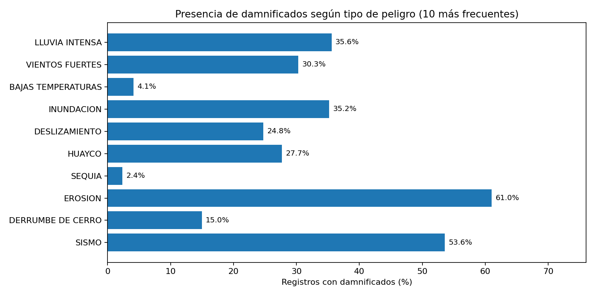
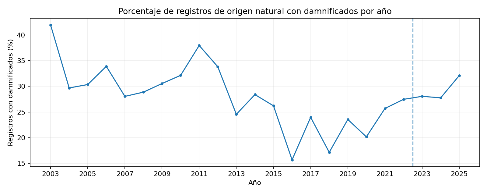
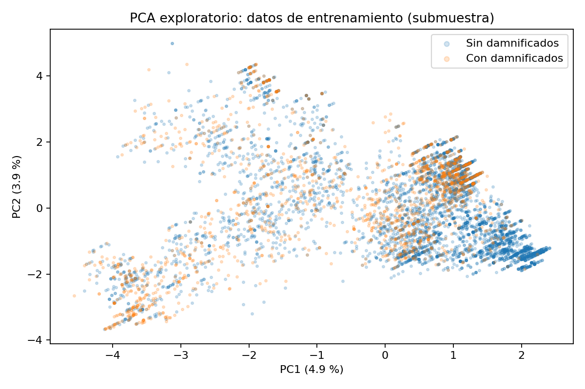

# Sesiones 3 y 4 · Resultados preliminares de INDECI (Perú, 2003–2025)

**Pregunta del proyecto:** clasificación de registros de emergencias de origen natural según presencia o ausencia de personas damnificadas. **Fuente:** archivo original `BD_2003-2025_EMERGENCIAS.csv` proporcionado por INDECI/SINPAD.

## Alcance de este avance

Se adaptó el **laboratorio A** recibido en `S3S4_parte1.qmd` y su informe automático de EDA a las variables reales de INDECI. Se ejecutaron en Python verificaciones de la base, tabulaciones, pruebas de asociación, preparación de un CSV analítico, gráficos y exploraciones preliminares de PCA e importancia por permutación. La adaptación en R/Quarto está lista para ejecutarse en RStudio; **no fue posible renderizarla aquí porque el entorno no dispone de R ni Quarto**. El ZIP recibido **no contenía** el cuaderno de la parte B (ensambles en Python), por lo que no se atribuyen resultados a ese laboratorio ausente.

## 1. Lectura y calidad

| Indicador | Resultado |
|---|---:|
| Registros originales | 142 139 |
| Variables originales | 49 |
| Registros clasificados como origen natural | 106 301 |
| Registros con al menos un damnificado | 29 653 (27,90 %) |
| Registros con cero damnificados | 76 648 (72,10 %) |
| Fechas no interpretables después de aplicar la regla documentada por año | 0 |
| Filas completas duplicadas en la base original | 0 |
| Códigos SINPAD repetidos dentro de origen natural | 4 repeticiones |

Los ceros se conservaron. Los códigos SINPAD repetidos no se eliminaron porque podrían representar entradas relacionadas y no necesariamente errores. Se preservó el archivo original. La identificación de cero damnificados como ausencia está condicionada a la interpretación documentada de la variable en SINPAD.

## 2. Hipótesis bivariadas y magnitud de asociación

H0: la presencia de damnificados no se asocia con la característica analizada en estos registros. Se aplicó chi-cuadrado de Pearson y V de Cramér como medida de asociación categórica.

| Característica | χ² | gl | V de Cramér | p |
|---|---:|---:|---:|---|
| Tipo de peligro | 9 895,89 | 15 | 0,305 | < 0,001 |
| Departamento | 4 870,24 | 25 | 0,214 | < 0,001 |
| Región natural | 2 642,88 | 3 | 0,158 | < 0,001 |
| Mes de ocurrencia | 2 098,37 | 11 | 0,140 | < 0,001 |

**Interpretación:** en los registros publicados existe asociación entre las cuatro variables y la presencia de damnificados; la mayor asociación de las examinadas corresponde al tipo de peligro. Los valores p no implican que el efecto sea importante en términos prácticos ni prueban causalidad. Estas pruebas no miden todavía el rendimiento predictivo.

## 3. Preparación para aprendizaje automático

Se eligió provisionalmente un conjunto de cinco predictores disponibles en la ficha del registro: **tipo de peligro, departamento, región natural, mes y año**. La variable dependiente es **presencia de damnificados** (sí/no). Los registros SINPAD y distrito se conservaron para trazabilidad, no como predictores iniciales. Tampoco se incorporaron afectados, lesionados, fallecidos, viviendas dañadas o ayuda humanitaria porque son posibles consecuencias posteriores al evento y generarían fuga de información.

| Subconjunto | Periodo | n | Con damnificados | Proporción |
|---|---|---:|---:|---:|
| Desarrollo | 2003–2022 | 72 300 | 19 571 | 27,07 % |
| Prueba final reservada | 2023–2025 | 34 001 | 10 082 | 29,65 % |

La partición está definida por tiempo para evaluar años posteriores y no ha sido utilizada para informar ninguna comparación final de modelos. Los pasos de imputación/codificación/escalado se **ajustarán solamente con el conjunto de desarrollo** en Quarto.

## 4. Exploración de características y dimensionalidad

Como comprobación exploratoria independiente, se calculó una **importancia por permutación** sobre una submuestra del conjunto de desarrollo con Random Forest: tipo de peligro fue la variable con mayor disminución media de AUC al permutarla, seguida por departamento. **Esto no es Boruta**, ni representa la interpretación definitiva de todos los modelos. El AUC calculado en esta submuestra es de validación interna, **no de prueba final**.

Se aplicó PCA exploratorio a variables categóricas codificadas numéricamente y estandarizadas (submuestra de desarrollo). Su interpretación no es equivalente al PCA de las treinta medidas continuas del ejercicio de biopsias. Los valores y gráficos quedan disponibles en las carpetas `resultados/tablas` y `resultados/figuras`.

**Pendiente de ejecutar en RStudio:** Boruta y UMAP del laboratorio A, incluidos como bloques opcionales en el Quarto. La parte B del laboratorio docente no se encontraba dentro del ZIP recibido.

## 5. Decisiones y limitaciones que deben mantenerse

- No modificar ni borrar el CSV original; guardar el historial de operaciones.
- No convertir ceros en NA; verificar el significado documentado de cero en la fuente.
- No usar variables de daño posterior como si fueran información disponible al momento de predecir.
- No sobreinterpretar valores p pequeños, correlaciones o gráficos de PCA/UMAP como causalidad o desempeño futuro.
- No escoger modelos ni hiperparámetros utilizando los años 2023–2025.
- Una misma emergencia podría generar registros relacionados en distintos distritos; revisar agrupamientos antes de la validación cruzada definitiva.
- El desempeño de años futuros podría variar porque la calidad y los procesos de registro cambian con el tiempo.

**Fuente institucional:** https://www.datosabiertos.gob.pe/dataset/emergencias-y-da%C3%B1os-nivel-nacional-por-departamento
