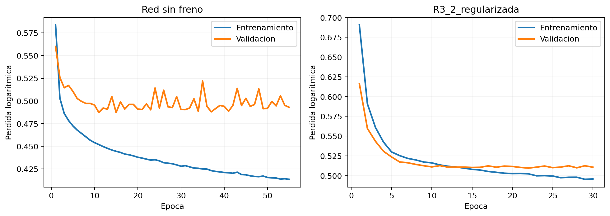
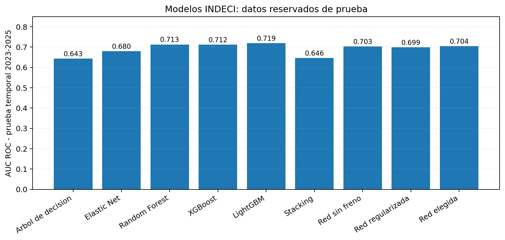

# Entregable de la Unidad II: sesiones 5 y 6

**Proyecto:** Clasificación de registros de emergencias naturales con personas damnificadas, Perú, 2003–2025.

**Fuente:** [INDECI – Emergencias y daños a nivel nacional](https://www.datosabiertos.gob.pe/dataset/emergencias-y-da%C3%B1os-nivel-nacional-por-departamento).

**Pregunta:** ¿Cuál es el desempeño predictivo y la interpretabilidad de los modelos de aprendizaje automático para clasificar las emergencias de origen natural registradas en el Perú durante 2003–2025 según la presencia de personas damnificadas?

**Responsable:** Completar con el nombre del estudiante.

## Tarea 1. Tabla de modelos y comparación con la red neuronal

Se analizaron **106 301 registros** de origen natural, de los cuales **29 653** presentan al menos una persona damnificada (27,9 %). La unidad de análisis es el registro de emergencia distrital, no una persona. Se compararon modelos binarios con las mismas cinco variables predictoras registradas: tipo de peligro, departamento, región natural, mes y año. No se incluyeron conteos de daños entre los predictores, porque ya reflejan las consecuencias del evento.

**Validación y evaluación:** desarrollo 2003–2022 (**72 300** registros); cinco validaciones temporales de un año en 2018, 2019, 2020, 2021 y 2022, siempre entrenando con años anteriores. Prueba independiente: 2023–2025 (**34 001** registros). Los valores después de ± son **desviaciones estándar entre los cinco años de validación**, no errores estándar ni intervalos de confianza. La red neuronal se seleccionó con una validación independiente de 2022, por lo que su AUC de validación **no es directamente comparable** con el promedio de cinco validaciones de los modelos clásicos.

| Modelo | Validación 2018–2022: AUC media ± DE | AUC prueba 2023–2025 | Interpretabilidad | Comentario |
|---|---:|---:|---|---|
| Arbol de decision | 0,695 ± 0,037 | 0,643 | Alta | Modelo simple, pero obtuvo el AUC menor de los comparados. |
| Elastic Net | 0,711 ± 0,028 | 0,680 | Alta | Coeficientes explícitos; rendimiento menor que los modelos de árboles. |
| Random Forest | 0,753 ± 0,031 | 0,713 | Media | Buen rendimiento relativo; requiere herramientas para explicarlo. |
| XGBoost | 0,746 ± 0,029 | 0,712 | Media | Ensamble de boosting con rendimiento cercano al bosque. |
| LightGBM | 0,755 ± 0,040 | 0,719 | Media | Mayor AUC de prueba entre los modelos tradicionales; sensibilidad insuficiente con umbral 0,50. |
| Stacking | 0,675 ± 0,039 | 0,646 | Baja | La combinación no mejoró a sus modelos base en esta evaluación temporal. |
| Red neuronal elegida | No se calculó CV de 5 años; validación 2022: 0,754 | 0,704 | Baja | Dos capas 32–16; dropout 0,25; tasa 0,0007. |

### ¿Qué modelo elijo y por qué?

**LightGBM es el mejor candidato provisional según la discriminación en la prueba temporal** (AUC 0,719); su resultado es ligeramente superior a Random Forest (0,713) y XGBoost (0,712). Estas diferencias son pequeñas y no se ha realizado una prueba formal de diferencias entre AUC, por lo que **no afirmamos superioridad estadística**. Elastic Net es más interpretable, pero obtuvo un AUC inferior (0,680). La clasificación sigue siendo limitada: con umbral 0,50, LightGBM dejó sin detectar **8 447 registros con damnificados** de 10 082 positivos en la prueba (sensibilidad 16,2 %). Antes de utilizarlo en decisiones reales, se requiere validar un umbral sensible y variables predictoras adicionales.

### ¿Conviene una red neuronal?

Los datos son **tabulares** y contienen alrededor de 106 mil registros. Se probó un perceptrón multicapa (*MLP*) con capas densas; CNN, LSTM y Transformer no corresponden directamente al formato de esta tabla. La mejor red seleccionada mediante validación de 2022 obtuvo AUC 0,704 en prueba, sin mejorar al ensamble LightGBM (0,719). Por parsimonia, se mantiene LightGBM como candidato para estudios posteriores; no se concluye que una red neuronal sea inútil en general.

## Tarea 2. Tres referencias científicas verificadas

Se cotejaron título, autores, fecha, revista y DOI con páginas editoriales o institucionales. Las tres publicaciones existen; ninguna se inventó.

| Referencia bibliográfica | ¿Existe? | ¿Autores y año correctos? | Lugar de verificación |
|---|---|---|---|
| Hu, X., Hu, J. y Hou, M. (2022). *A two-step machine learning method for casualty prediction under emergencies*. *Journal of Safety Science and Resilience, 3*(3), 243–251. DOI: [10.1016/j.jnlssr.2022.03.001](https://doi.org/10.1016/j.jnlssr.2022.03.001) | Sí | Sí | [Revista / Elsevier](https://www.sciencedirect.com/science/article/pii/S2666449622000160) |
| Kumar, C., Walton, G., Santi, P. y Luza, C. (2023). *An ensemble approach of feature selection and machine learning models for regional landslide susceptibility mapping in the arid mountainous terrain of Southern Peru*. *Remote Sensing, 15*(5), 1376. DOI: [10.3390/rs15051376](https://doi.org/10.3390/rs15051376) | Sí | Sí | [MDPI](https://www.mdpi.com/2072-4292/15/5/1376) |
| Quiliche, R., Maçaira, P., Baião, F. A. y Leiras, A. (2025). *Identifying final demand points for aid in the aftermath of sudden-onset climate-related disasters in Peru: A supervised learning approach*. *International Journal of Disaster Risk Reduction, 127*, 105593. DOI: [10.1016/j.ijdrr.2025.105593](https://doi.org/10.1016/j.ijdrr.2025.105593) | Sí | Sí | [Repositorio institucional Hanken](https://research.hanken.fi/en/publications/identifying-final-demand-points-for-aid-in-the-aftermath-of-sudde/) |

**Interpretación bibliográfica:** Hu et al. (2022) estudian predicción de víctimas en emergencias; Kumar et al. (2023) comparan ensambles en deslizamientos del sur del Perú; Quiliche et al. (2025) proponen clasificadores supervisados para vulnerabilidad y demanda de ayuda ante desastres en el Perú. Sus poblaciones y desenlaces **no son idénticos** a los registros SINPAD y, por tanto, no se deben comparar directamente sus métricas con las nuestras.

**Mini-RAG:** ejercicio opcional, no ejecutado aquí. Las referencias fueron verificadas en sus fuentes originales; no se afirma que un sistema RAG haya respondido con ellas.

## Tarea 3. Adelanto de artículo científico (una página)

Este estudio preliminar busca comparar el desempeño de modelos de aprendizaje automático para clasificar los registros de emergencias de origen natural en el Perú según la presencia o ausencia de personas damnificadas. Se utilizó información pública del INDECI/SINPAD correspondiente a 2003–2025. De los 142 139 registros originales, se incluyeron 106 301 clasificados como de origen natural; 29 653 (27,9 %) registraron al menos una persona damnificada. Las variables predictoras fueron el tipo de peligro, el departamento, la región natural, el mes y el año. Los daños humanos y materiales posteriores al evento no se incorporaron como predictores para evitar fuga de información.

Se compararon árboles de decisión, regresión logística penalizada mediante Elastic Net, Random Forest, XGBoost, LightGBM y Stacking. El conjunto de desarrollo abarcó 2003–2022 (72 300 registros), con cinco validaciones cronológicas de un año (2018–2022); la evaluación final empleó 2023–2025 (34 001 registros). LightGBM presentó el AUC promedio de validación más alto (0,755 ± 0,040) y el mayor AUC de prueba entre los métodos clásicos (0,719), seguido de Random Forest (0,713) y XGBoost (0,712). La arquitectura neuronal elegida, con 32 y 16 neuronas ocultas, dropout de 0,25 y tasa de aprendizaje de 0,0007, alcanzó un AUC de 0,704 en el periodo de prueba y no superó LightGBM.

Un hallazgo relevante es que la discriminación de los modelos fue moderada y menor que la observada en la validación histórica. Con umbral 0,50, LightGBM dejó sin detectar 8 447 de los 10 082 registros con damnificados en la prueba, lo que equivale a una sensibilidad de 16,2 %. En este contexto, sería inadecuado recomendar su uso operativo sin revisar el umbral, la calibración y el costo de los falsos negativos. Trabajos recientes sobre desastres en el Perú respaldan la comparación de ensambles y el estudio de la demanda de ayuda (Kumar et al., 2023; Quiliche et al., 2025), mientras que Hu et al. (2022) muestran el valor de estudiar explícitamente impactos humanos.

En adelante será necesario comprobar la estabilidad temporal, optimizar umbrales usando exclusivamente datos de desarrollo, evaluar las diferencias regionales, explorar nuevas variables anteriores al resultado y aplicar técnicas de explicabilidad. Estos resultados constituyen una evaluación retrospectiva de registros existentes, no un sistema validado de alerta temprana ni evidencia de causalidad.

## Tarea 4. Red neuronal con datos INDECI

### Preparación, validación y selección

- Se utilizó la misma variable binaria: **1** = registro con al menos un damnificado; **0** = sin damnificados.
- Los predictores categóricos se transformaron mediante *one-hot encoding*; la variable año se estandarizó usando solo los datos con que se ajustaba cada modelo.
- La red se entrenó inicialmente con **2003–2021** y se seleccionó con la validación de **2022**. Se compararon cuatro configuraciones candidatas de profundidad, número de neuronas, dropout y tasa de aprendizaje.
- La elección se hizo por AUC en la validación, dando preferencia a la arquitectura más pequeña si la diferencia era menor que **0,005**. La seleccionada fue **32–16 neuronas, dropout 0,25, tasa 0,0007**, con mejor época 23.
- Finalmente, se reentrenó el modelo seleccionado con 2003–2022 por el número de épocas elegido, sin consultar el conjunto de prueba para ajustar hiperparámetros.

| Configuración | Capas ocultas | Dropout | Tasa de aprendizaje | AUC validación 2022 | Mejor época |
|---|---|---:|---:|---:|---:|
| Red sin freno | 128-64 | 0.00 | 0.0010 | 0,773 | 11 |
| R3_1_pequena | 8 | 0.10 | 0.0010 | 0,746 | 28 |
| R3_2_regularizada | 16-8 | 0.30 | 0.0010 | 0,749 | 22 |
| R3_3_media | 32-16 | 0.25 | 0.0007 | 0,754 | 23 |
| R3_4_mayor | 64-32 | 0.35 | 0.0005 | 0,753 | 15 |

### ¿La red sin freno mostró sobreajuste?

Sí, **hay indicios de sobreajuste**: la pérdida de validación alcanzó su mínimo alrededor de la época **15**, mientras la pérdida de entrenamiento continuaba descendiendo hasta la época 55. La separación de las curvas es relativamente modesta y debe interpretarse junto con los resultados de prueba. La red con dropout y parada temprana limitó sus épocas mediante la evaluación de 2022.

### Evaluación final en 2023–2025 (misma prueba temporal)

| Modelo | AUC en prueba | Positivos no detectados (FN) | Falsas alarmas (FP) | Sensibilidad |
|---|---:|---:|---:|---:|
| Elastic Net | 0,680 | 9,706 | 364 | 3.7 % |
| Random Forest | 0,713 | 9,161 | 370 | 9.1 % |
| Red sin freno | 0,703 | 6,601 | 3,495 | 34.5 % |
| Red con freno | 0,699 | 8,548 | 746 | 15.2 % |
| Red elegida en R3 | 0,704 | 8,520 | 1,003 | 15.5 % |

**Resultado:** la red elegida mediante la validación de 2022 registró AUC **0,704**, **8,520 falsos negativos** y **1,003 falsos positivos** en los 34 001 registros de prueba. El modelo más complejo sin regularización obtuvo AUC **0,703**; sus falsos negativos fueron menores, pero generó bastantes más falsas alarmas. No conviene seleccionar un modelo exclusivamente por AUC: deben explicitarse las consecuencias de cada error.

### ¿Vale la pena una red con estos datos?

Por ahora, **no mostró una ventaja clara sobre el mejor ensamble**: AUC de red elegida 0,704 frente a 0,719 de LightGBM. El problema más delicado es la elevada proporción de registros con damnificados no detectados bajo el umbral 0,50. Se necesitan sensibilidad, calibración, análisis de equidad regional y validación externa antes de recomendar decisiones de asignación de recursos basadas en estas predicciones.

### Reproducibilidad y enlace a GitHub

- Scripts: `scripts/S05S06_modelado_indeci.py` y `scripts/S05S06_redes_indeci.py`.
- Cuaderno reproducible: `notebooks/S56_red_con_mis_datos.ipynb`.
- Tablas y curvas: `resultados/tablas/S05S06_*` y `resultados/figuras/S05S06_*`.
- **Enlace de GitHub:** pendiente de incorporar después de publicar el cuaderno en tu repositorio. No se inventa una URL de publicación.

## Declaración de uso de inteligencia artificial

Se utilizó asistencia de IA para apoyar la estructuración del código, la organización de los documentos y la redacción preliminar. Las métricas que se reportan se calcularon mediante scripts Python ejecutados sobre los registros reales de INDECI. Las tres referencias se contrastaron con fuentes editoriales o institucionales y se conservaron los datos originales sin modificaciones. La interpretación y responsabilidad de la entrega corresponden al estudiante.

## Limitaciones esenciales

Esta evaluación retrospectiva no predice la ocurrencia del desastre. Tampoco dispone de información socioeconómica, geofísica o meteorológica previa que probablemente mejore el poder predictivo. Posibles cambios administrativos y de completitud del SINPAD a lo largo del tiempo pueden alterar el desempeño. El conjunto de prueba 2023–2025 se utilizó para evaluación final y no para seleccionar variables o umbrales.
